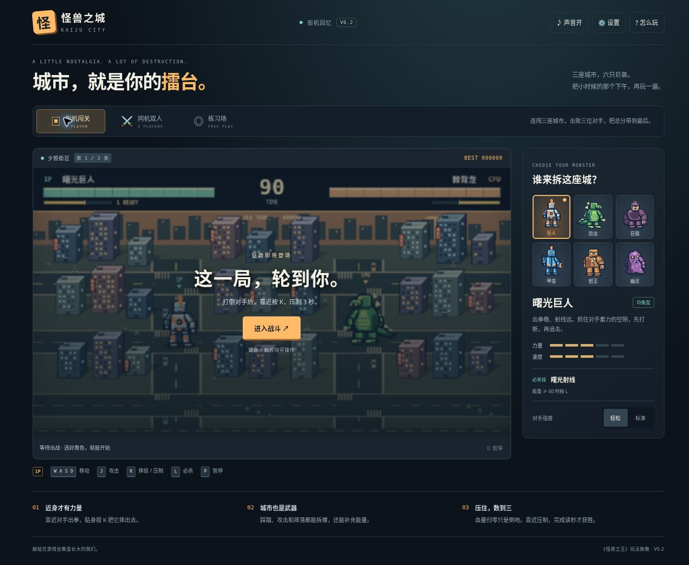

# 怪兽之城 · Kaiju City

一个可以直接在浏览器里玩的像素怪兽格斗游戏。选择巨兽，在城市街区中移动、拆楼、摔投，最后用 **三秒压制** 赢下对局。

玩法灵感来自童年街机《怪兽之王》。游戏逻辑、像素角色、城市建筑与合成音效均为独立实现。



## 现在能玩什么

| 模式 | 内容 |
| --- | --- |
| 街机闯关 | 夕照街区 → 临海码头 → 霓虹都心，连续挑战三位电脑对手；每关 90 秒 |
| 同机双人 | 一台电脑、两套键盘操作；双方独立选角，下一局轮换城市 |
| 练习场 | 无限时间、不还手的练习对手、自动回复能量，可反复练习技能和压制 |

六种可选角色具有不同的生命、速度、力量与必杀：曙光巨人、棘背龙、铁拳巨猿、苍蓝甲虫、琥珀岩王、紫雾幽灵。

三张地图具有独立的城市布局、道路、建筑配色与背景。战斗包含连击、强化第三击、近身摔投、射线、火焰、能量弹、冲撞和范围震波。楼宇可被踩踏或攻击破坏，倒塌后留下瓦砾。

## 运行

需要 Node.js 22 或更高版本；项目没有第三方运行依赖，也不需要构建。

```bash
npm start
```

打开终端显示的本地地址，默认是 `http://localhost:4173/`。也可以使用任意静态服务器托管 `dist/`。

端口可通过 `PORT` 环境变量修改，监听地址可通过 `HOST` 修改。`npm run dev` 与 `npm start` 等价。

## 操作

| 动作 | 1P | 2P，仅同机双人 |
| --- | --- | --- |
| 移动 | W / A / S / D | 方向键 |
| 攻击 | J | 逗号 `,` 或小键盘 1 |
| 摔投 / 压制 | K，也可用空格 | 句号 `.` 或小键盘 2 |
| 必杀 | L | 斜线 `/` 或小键盘 3 |
| 暂停 / 继续 | P 或 Esc | 共用 |

单人模式也可用方向键移动。按住攻击键可以连续攻击；挣脱压制需要连续、独立地按下攻击键。

手机使用画面旁或下方的方向与攻击按钮，支持移动和攻击同时按下。横屏时，操作区会排列在画面两侧。同机双人模式需要两套键盘操作。

## 对局规则

- 血量归零后进入 **7 秒倒地**。贴近倒地对手，按摔投键发起压制，持续 **3 秒** 获胜。
- 被压制的玩家快速、独立地按攻击键 **8 次** 可以挣脱；按住不放不会自动挣脱。
- 倒地后未被压制的角色会恢复少量生命站起来；练习对手恢复满生命。
- 命中与拆楼可以获得能量；必杀消耗 **60 点**。必杀有明显的蓄力与攻击方向提示，可以躲开或打断。
- 时间耗尽时，按剩余生命比例判定胜负。已经开始的压制会完成判定。
- 街机关卡之间保留总分、拆楼数量与最高连击；角色生命、能量和城市在下一关重置。失败或三关全部完成后，可以开始新一轮。
- 练习场不计入最高分；完成压制或倒地恢复后，练习对手继续可用，重置按钮可恢复整个场地。
- 切换标签页或失去窗口焦点会自动暂停。战斗中打开设置 / 帮助会暂停，关闭后恢复；切到后台后则保持暂停。

声音、音量、震屏、难度与上次模式保存在当前浏览器中。系统启用“减少动态效果”时，默认关闭震屏；之后可手动调整。

## 检查与测试

```bash
npm run check
npm test
```

测试使用 Node.js 内置测试运行器，执行真实 `dist/game.js` 的逻辑。测试环境提供 Canvas / DOM 桩，状态访问只在测试运行时注入，正式游戏不会暴露调试接口。

覆盖内容包括：三关累计与重试、两名玩家独立输入、压制与挣脱、倒地恢复、练习模式、技能范围 / 冷却 / 能量、冲撞和蓄力打断、不同帧率下的移动与伤害、暂停和失焦处理、弹窗恢复，以及快速点按与键盘 / 触控同时输入。

GitHub Actions 工作流运行语法检查和逻辑测试。浏览器画面与布局检查独立于上述逻辑测试。

## 项目结构

| 路径 | 作用 |
| --- | --- |
| `dist/index.html` | 模式、选角、结算、帮助和设置界面 |
| `dist/style.css` | 桌面、手机竖屏和横屏布局 |
| `dist/game.js` | 对战状态、关卡、电脑对手、输入、特效、音效和绘制 |
| `dist/art.js` | 六个角色、动作、城市建筑和瓦砾的像素绘制 |
| `scripts/serve.mjs` | 零依赖本地静态服务器 |
| `tests/` | 实际游戏逻辑的自动测试与 DOM 测试环境 |
| `.github/workflows/ci.yml` | GitHub 自动检查 |
| `docs/preview.jpg` | 当前版本浏览器画面 |

主要状态包括选角、倒计时、对战、暂停与结算。模拟使用固定时间步长；输入区分键盘与每个触点，快速点按会被保留到下一次模拟更新。电脑对手根据已显示的场面和蓄力动作决策，不读取未来输入。

## 部署

`dist/` 是完整的静态站点，可部署到任意支持静态文件的托管服务。无需数据库、后端 API、环境密钥或资源下载。

当前试玩入口：[怪兽之城](https://kaiju-city-clash-kingsley.kingsleyli0114.chatgpt.site/)（该入口保持原有的个人访问权限）。

## 版本范围

当前版本为 **0.2.0**。已提供完整的三关街机流程、同机双人和练习模式。网络联机、手柄操作、原作逐帧动作与完整原作关卡尚未包含。
